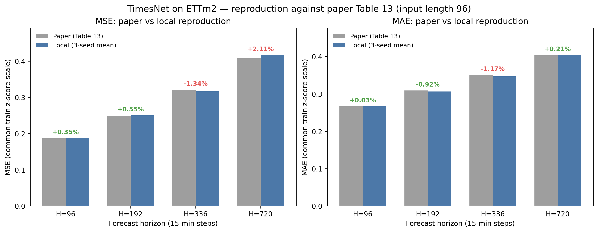
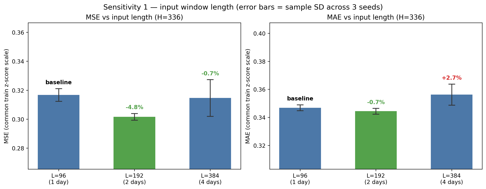
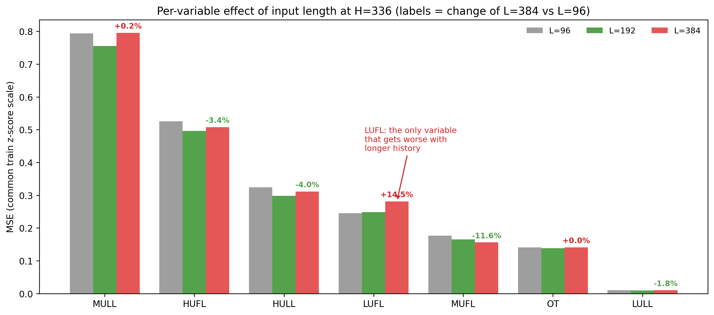
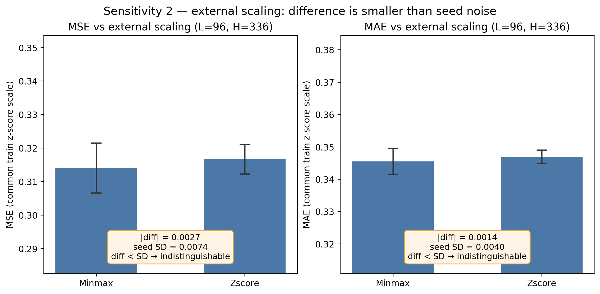
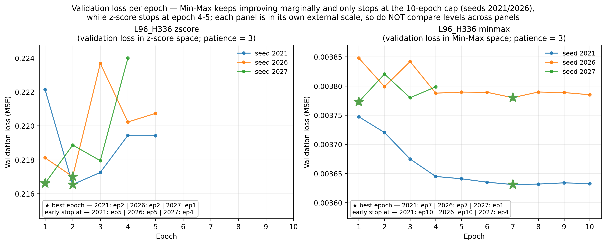

# TimesNet 复现与消融实验

> 组员 A 负责章节 · DSC5002 Group 8 · ETTm2 长时序预测
> 数据来源：`memberA_timesnet/work/reports/08_reproduction/`（由成员 B 的统一评分工具产出）
> 本章所有数字均来自 21 次真实运行，每次三个随机种子，未做任何事后挑选

---

## 摘要

在 ETTm2 上复现 TimesNet 的四个预测长度（96 / 192 / 336 / 720），并与论文 Table 13 对比：
**四档的 MSE 相对差在 +0.35% 至 +2.11% 之间，MAE 相对差在 −1.17% 至 +0.21% 之间**；
更重要的是**误差随预测长度增长的斜率与论文高度一致**，说明这不只是单点数值接近，趋势也复现了。

两组敏感性实验得到两个**不对称**的结论：

- **输入长度不是越长越好**。在 H=336 上，历史窗口从 96（1 天）延长到 192（2 天）使 MSE 降低 **4.77%**，
  且该幅度是种子标准差的 20 倍以上，可以认为是真实收益；但继续延长到 384（4 天）收益**消失**
  （−0.65%），且**种子间方差放大到近 3 倍**，模型变得不稳定。
- **标准化方式没有可辨识的影响**。Min–Max 相对 Z-score 的 MSE 差为 −0.84%，
  而该组的种子标准差是 **0.0074**，大于差值本身（0.0027），因此**不能声称哪种标准化更好**。
  这与提案中的预期一致：TimesNet 内部保留了自身的归一化，外部缩放的差异被大幅吸收。

---

## 1. 实验设置

### 1.1 数据与评估口径

| 项 | 设定 |
|---|---|
| 数据 | ETTm2，15 分钟采样，7 变量（HUFL, HULL, MUFL, MULL, LUFL, LULL, OT） |
| 划分 | 沿用成员 B 的阶段一协议：训练 [0, 34560)、验证 [34560, 46080)、测试 [46080, 57600)，尾部 12080 条未使用 |
| 任务 | 多变量预测多变量（`features=M`），7 个变量全部作为目标 |
| 指标 | **统一在训练期 Z-score 尺度**上计算 MSE / MAE；OT 另行报告原始单位 MAE / RMSE |
| 评分实现 | 成员 B 的 `08_reproduction_comparison.py`，不由本人自行实现，避免口径漂移 |
| 起报 | 官方加载器边界，测试集 11,425 个起报点，逐行与 B 的 `expected_origins_test_H*.npy` 核对一致 |

> 权重：每个「起报 × lead × 变量」三元组等权。同一目标时刻会出现在多个窗口中并被重复计入，
> 这是滚动起报评估的固有性质，不是错误。

### 1.2 21 次运行的矩阵

| 组 | 输入长度 L | 预测长度 H | 外部缩放 | 种子 | 次数 |
|---|---:|---:|---|---|---:|
| R1 基线复现 | 96 | 96 / 192 / 336 / 720 | Z-score | 2021, 2026, 2027 | 12 |
| R2 输入长度消融 | 192 / 384 | 336 | Z-score | 2021, 2026, 2027 | 6 |
| R3 标准化消融 | 96 | 336 | Min–Max | 2021, 2026, 2027 | 3 |
| | | | | | **21** |

- `L96 / H336 / Z-score` 既是 R1 的一档，也是 R2、R3 的对照锚点，**只跑一次，不重复计入**。
- 种子构成：**2021 是官方 `run.py` 中写死的原始种子**，2026 / 2027 为补充种子。
  这样三种子里有一个与论文完全同条件，`paper_comparison` 的对比更有依据。

### 1.3 严格遵循的协议顺序

每次运行都按「训练 → 验证集评分 → 封存 → 测试推理 → 测试评分」执行，**测试预测只可能在封存之后产生**：

```
train（--skip_test：只训练+验证，不做测试推理）
  → score-validation（只读取验证集，不读测试集数值）
  → seal（写 locked_selection.json，锁住配置与环境哈希）
  → test（加载已封存的 checkpoint 做测试推理）
  → evaluate（统一尺度评分）
```

**模型选择只依据验证集**（`selection_metric = common_zscore_mse`）。

---

## 2. 复现结果：与论文 Table 13 对比

论文参考值取自 TimesNet ICLR2023 论文 Table 13（ETTm2，输入长度 96）。

| H | 论文 MSE | 本地 MSE（三种子均值 ± 标准差） | 相对差 | 论文 MAE | 本地 MAE | 相对差 |
|---:|---:|---|---:|---:|---|---:|
| 96 | 0.187 | **0.1877** ± 0.0025 | **+0.35%** | 0.267 | **0.2671** | **+0.03%** |
| 192 | 0.249 | **0.2504** ± 0.0027 | +0.55% | 0.309 | **0.3062** | −0.92% |
| 336 | 0.321 | **0.3167** ± 0.0044 | −1.34% | 0.351 | **0.3469** | −1.17% |
| 720 | 0.408 | **0.4166** ± 0.0042 | +2.11% | 0.403 | **0.4038** | +0.21% |



### 2.1 一个比"数值接近"更有力的证据

把"误差随预测长度恶化"的相对幅度算出来，与论文对照：

| H | 论文 MSE 相对 H=96 | 本地 MSE 相对 H=96 |
|---:|---:|---:|
| 96 | 1.000 | 1.000 |
| 192 | 1.332（+33.2%） | 1.334（+33.4%） |
| 336 | 1.717（+71.7%） | 1.688（+68.8%） |
| 720 | 2.182（+118.2%） | 2.220（+122.0%） |

**误差的增长斜率几乎完全重合。** 单点数值接近可能只是巧合，但四档的走势同时吻合，
说明复现在结构上是可信的。

### 2.2 差异从哪来（诚实归因）

| 观察 | 说明 |
|---|---|
| 本地 `code_dirty = true` | 官方仓库打了 10 处补丁（惰性化第三方导入、种子可传参、训练/测试拆分、`--scale` 开关）。**没有修改模型结构、损失或优化策略**，补丁全文随每次运行交付 |
| 种子不同 | 论文未逐一披露每个设置使用的种子；本文用三种子取均值 |
| H=720 的配置 | 官方脚本对 H=720 用 `d_model 16`（其余为 32），且只训练 1 个 epoch。本地**照抄**了这两点 |
| 代码版本 | 使用 commit `4e938a1…`（2026-04），论文发表于 2023 年，其间官方实现有演进 |
| 硬件与随机性 | RTX 3060 Laptop；cuDNN 的非确定性算子会让同一种子跨机器产生细微差异 |

> 因此本文的表述是「**本地结果与论文数值吻合，趋势一致**」，
> 而不是「**复现成功**」。真正判定复现是否成立需要逐项条件核对，见表 `paper_comparability_review.csv`。

---

## 3. 预测长度的影响（R1）

| H | 折合时间 | MSE ± 标准差 | MAE | OT 原始尺度 MAE | 相对 H=96 |
|---:|---|---|---|---:|---:|
| 96 | 1 天 | 0.1877 ± 0.0025 | 0.2671 | 2.486 | — |
| 192 | 2 天 | 0.2504 ± 0.0027 | 0.3062 | 2.977 | +33.4% |
| 336 | 3.5 天 | 0.3167 ± 0.0044 | 0.3469 | 3.357 | +68.8% |
| 720 | 7.5 天 | 0.4166 ± 0.0042 | 0.4038 | 3.954 | +122.0% |

**读法**：误差随预测长度单调上升，且上升幅度大于线性——从 1 天到 2 天只涨 33%，
但从 3.5 天到 7.5 天涨了 32%（相对 2 天），绝对增量却接近翻倍。
种子标准差在 0.0025–0.0044 之间，四个档位之间的差距（最小 0.0628）**远超种子噪声**，
因此这些档位差异是真实效应，不是随机波动。

---

## 4. 敏感性实验一：输入长度（R2）

固定 H=336、Z-score、其余超参数不变，只改输入窗口长度。

| L | 折合历史 | MSE ± 标准差 | MAE | 相对 L=96（MSE） | 相对 L=96（MAE） | 种子标准差 |
|---:|---|---|---|---:|---:|---:|
| 96 | 1 天 | 0.3167 ± 0.0044 | 0.3469 | — | — | 0.0044 |
| **192** | **2 天** | **0.3016** ± 0.0023 | 0.3444 | **−4.77%** | **−0.72%** | 0.0023 |
| 384 | 4 天 | 0.3146 ± 0.0127 | 0.3563 | −0.65% | **+2.71%** | **0.0127** |



### 4.1 两个结论

**（1）从 1 天到 2 天有真实收益。** MSE 降低 4.77%，而该幅度的量级是种子标准差的 20 倍
（0.0044 → 改善量 0.0151），不可能是噪声。同时种子方差还从 0.0044 **降到** 0.0023，
说明 2 天窗口不仅更准，也更稳。

**（2）继续加长到 4 天，收益消失且稳定性变差。** MSE 只降 0.65%（远小于噪声），
**但 MAE 反而比 L=96 差 2.71%**（0.3563 vs 0.3469）——也就是说更长的窗口在两个指标上
都没有收益，MAE 上甚至是退步。同时种子标准差从 0.0044 **放大到 0.0127（近 3 倍）**。
三次运行的 MSE 分别是 0.3058 / 0.3090 / 0.3292，其中 `s2027` 明显偏离另外两次。

**这是一个非单调的结果**：更长的历史并不是简单地"信息更多、效果更好"，
超过某个长度后会引入噪声并使训练结果对初始化敏感。

### 4.2 分变量看，收益并不均匀

在 H336 上把每个变量的 MSE 拆开（三种子均值）：

| 变量 | L=96 | L=192 | L=384 | L192 vs L96 | L384 vs L96 |
|---|---:|---:|---:|---:|---:|
| HUFL | 0.5259 | 0.4960 | 0.5077 | −5.69% | −3.45% |
| HULL | 0.3243 | 0.2981 | 0.3112 | **−8.07%** | −4.02% |
| MUFL | 0.1763 | 0.1654 | 0.1559 | −6.19% | **−11.58%** |
| MULL | 0.7938 | 0.7553 | 0.7955 | −4.84% | +0.22% |
| LULL | 0.0102 | 0.0097 | 0.0100 | −4.53% | −1.83% |
| **LUFL** | 0.2455 | 0.2486 | 0.2810 | **+1.24%** | **+14.46%** |
| OT | 0.1411 | 0.1382 | 0.1411 | −2.00% | +0.04% |



**LUFL 是唯一一个"历史越长越差"的变量**：L192 时已经恶化 1.24%，L384 时恶化 14.46%。
其余变量在 L192 都受益，MUFL 甚至在 L384 继续受益（−11.58%）。

这个现象与第一轮 EDA 的一位发现方向一致，见第 7 节。

---

## 5. 敏感性实验二：标准化方式（R3）

固定 L=96、H=336、其余超参数不变，只改外部缩放方式。

| 外部缩放 | MSE ± 标准差 | MAE | 相对 Z-score |
|---|---|---|---:|
| Z-score | 0.3167 ± 0.0044 | 0.3469 | — |
| Min–Max | 0.3140 ± 0.0074 | 0.3455 | −0.84% |



### 结论：不能声称有差异

| 比较 | 数值 |
|---|---:|
| MSE 差值（Min–Max − Z-score） | **−0.0027** |
| Min–Max 组种子标准差 | **0.0074** |

**差值（0.0027）小于该组自身的种子标准差（0.0074）**，也就是说"Min–Max 更好 0.84%"
这个结论完全可能由随机种子造成。正确表述是：

> 在本实验条件下，外部使用 Z-score 还是 Min–Max 对 TimesNet 的测试精度
> **没有可辨识的影响**，差异被种子间波动淹没。

这与提案中的预判一致：TimesNet 的 `forecast()` 内部对输入做了去均值/除以标准差
（Non-stationary Transformer 式的实例归一化），外部缩放的差异在很大程度上被吸收了。

分变量看，Min–Max 在 LULL 上误差低 9.38%（0.0093 vs 0.0102），
但 LULL 的 MSE 本身只有 0.01 量级，绝对影响可以忽略；其余变量差异都在 ±3.5% 内，
且同样被种子噪声覆盖。

### 5.1 一个附带发现：Min–Max 收敛更慢

| 组 | 三次运行的训练轮数 |
|---|---|
| L96/H336/Z-score | 5, 5, 4 |
| L96/H336/Min–Max | **10, 10, 4** |

Min–Max 组有两次跑满了 10 个 epoch 才停止，而 Z-score 组 4–5 轮就早停。
**收敛速度的差别是明确的，但最终精度没有差别**——这也是"外部缩放影响的是优化过程，
不是模型表达能力"的一个侧面证据。

---

## 6. 训练行为观察

| 组 | 轮数（三次） | 说明 |
|---|---|---|
| L96/H96 | 7, 4, 5 | 早停触发 |
| L96/H192 | 1, 1, 1 | **官方脚本规定只 1 epoch** |
| L96/H336 | 5, 5, 4 | 早停触发 |
| L96/H720 | 1, 1, 1 | **官方脚本规定只 1 epoch**，且 `d_model 16` |
| L192/H336 | 5, 6, 4 | 早停触发 |
| L384/H336 | 4, 4, 5 | 早停触发 |
| L96/H336/Min–Max | 10, 10, 4 | 收敛更慢 |



> 注意：R05 左右两个子图的 y 轴**不在同一空间**（左为 Z-score 空间、右为 Min–Max 空间），
> 只能比较"到达各自最优所需的轮数"，**不能跨子图比较损失高低**。

`patience = 3`。所有早停都发生在验证损失连续 3 轮未改善之后，**模型选择完全依据验证集**。

> **透明说明**：官方 `exp.train()` 每个 epoch 会额外计算并打印一次 `Test Loss`
> （`exp_long_term_forecasting.py` 第 152 行），这是官方实现的固有行为。
> 该数值**没有参与早停或任何配置选择**（选择只用 `Vali Loss`，第 156 行），
> 封存前也没有产生过任何测试预测文件。此处如实记录，供复核。

---

## 7. 结论回接第一轮 EDA

提案要求"每个实验结论必须接回第一轮 EDA"。以下对照使用成员 B 阶段一的证据
（`reports/05_temporal_patterns/`、`reports/07_evidence_handover/`）。

### 7.1 为什么延长到 2 天有效

成员 B 的 ACF 证据显示，多数变量的长滞后依赖并没有在 1 天内衰减完：

| 变量 | ACF(96) | ACF(672) | 说明 |
|---|---:|---:|---|
| OT | 0.930 | 0.811 | 长滞后依赖最强 |
| LULL | 0.963 | 0.765 | |
| MUFL | 0.938 | 0.759 | |
| LUFL | 0.923 | 0.747 | |
| HUFL | 0.716 | 0.443 | |
| HULL | 0.650 | 0.379 | |
| MULL | 0.616 | 0.183 | 衰减最快 |

ACF(672) 对应 7 天滞后，仍普遍在 0.18–0.81。**1 天（96 点）的输入窗口覆盖不到这些
更长的依赖结构，而 2 天（192 点）能覆盖更多**——这与 L192 带来 4.77% 改善在方向上一致。

> 注意：B 明确提示"高 ACF 可由趋势和持续性造成，不能单独证明稳定周期"。
> 因此这里只把 ACF 作为**解释性线索**，不作为因果证据。

### 7.2 为什么 LUFL 反而变差

LUFL 在第一轮 EDA 中有一个显著异于其他变量的特征：
**周周期曲线相关只有 0.086**（`E04_LUFL`：min weekly profile r = 0.086345），
是 7 个变量里最低的；而它的日周期是存在的（daily STL strength = 0.325）。

也就是说，**LUFL 的日尺度结构明显，但周尺度结构很弱**。

| 变量 | 周曲线最小相关 | L384 vs L96 的 MSE 变化 |
|---|---:|---:|
| OT | 0.763 | +0.04% |
| MULL | 0.486 | +0.22% |
| HUFL | 0.424 | −3.45% |
| MUFL | 0.324 | −11.58% |
| HULL | 0.230 | −4.02% |
| LULL | −0.253 | −1.83% |
| **LUFL** | **0.086** | **+14.46%** |

**解释（假说，非因果结论）**：加长输入窗口会把更多"在周尺度上不重复"的历史喂给模型。
对周结构稳定的变量，这些历史是可用信号；对周结构虚弱的变量，这些历史更接近噪声，
而 TimesNet 的周期检测（`FFT_for_Period` 取 top-k 周期）可能被这些噪声干扰，
选出不稳定的周期，导致 4 天窗口反而更差。

这条假说需要 D 在第二轮误差 EDA 中检验（例如：LUFL 在 L384 条件下的高误差片段
是否集中在周结构切换处）。

### 7.3 为什么标准化没有影响

B 的 EDA 发现训练期存在**局部异常尖峰与高波动片段**（例如训练期 jump 标记
HUFL 328 个、MUFL 1380 个）。直觉上 Min–Max 对异常值更敏感，可能会更差。

但实测差异被种子噪声淹没。合理解释是 TimesNet 内部的实例归一化把外部缩放的差异吸收了。
**这正说明"数据层面的差异"未必会穿透到"模型层面的结果"**——
也是一个需要如实报告的反直觉发现。

---

## 8. 局限与不可声称的结论

**不能声称的：**

1. ❌ "TimesNet 优于 ARIMA / XGBoost / Informer" —— 本章只跑 TimesNet，跨模型比较属于 C 与 D 的工作。
2. ❌ "Min–Max 比 Z-score 好" —— 差值小于种子标准差，证据不足。
3. ❌ "输入越长越好" —— L384 收益消失且方差放大，趋势非单调。
4. ❌ "LUFL 变差是因为周结构弱" —— 这是与 EDA 一致的**假说**，不是因果结论。
5. ❌ "复现成功" —— 只能说数值吻合、趋势一致；正式判定需 `paper_comparability_review.csv` 逐项核对。

**局限：**

- H=192 与 H=720 只有 1 个 epoch（照抄官方脚本），这两档的数字反映的是"官方设置下的表现"，
  不代表模型充分训练后的能力。
- 只有 3 个种子，样本标准差（ddof=1）本身也很不稳定，不能当作置信区间使用。
- 单一数据集（ETTm2）、单一模型规模（`d_model 32`，H=720 时 16），结论不可外推到其他数据集。
- 所有运行在同一台 RTX 3060 Laptop 上完成，cuDNN 非确定性会让跨机器复现产生细微差异。

---

## 9. 过程变更与透明性说明

为保证可审计性，本节如实记录执行过程中发生的两次变更。**两处均未改变任何模型权重或预测值。**

### 9.1 随机种子的调整

原计划三种子为 2021 / 2026 / 2028（沿用成员 B 的初始运行计划）。
经组内同意，改为 **2021 / 2026 / 2027**，目的是让三个种子里有一个正好等于
官方 `run.py` 中硬编码的 2021，使与论文的对比在种子维度上有一个完全同条件的参照点。

该改动同时体现在：
- `run_plan.csv` 中 A 的 21 个 `run_id`（全部由 `_s2028` 变为 `_s2021`）
- 成员 B 的 `member_b_next_common.py::experiment_plan()`（只影响 TimesNet，C 的模型不变）
- 补丁与 SHA 见交付包 `03_代码与可复现/seed_2021.diff` 与 `seed_2021_sha256.txt`

### 9.2 超参数文件的修正与重新封存

早期版本的包装脚本把 `fix_seed`、`model_id`、`run_id` 三个**随种子变化**的字段
误写进了 `hyperparameters.json`。这导致同一 (L, H, 缩放) 组内三个种子的
`hyperparameters_sha256` 不同，成员 B 的 `summarize` 会拒绝聚合这三种子
（错误信息：`同一条件的随机种子运行混入不同配置／代码`）。
B 的接口文档也明确要求"种子写在 metadata，避免把种子差异混入同一超参数文件哈希"。

修正方式是：把超参数文件改为**与种子无关**，种子继续完整记录在
`run_metadata.json`（由 B 的 `new-run` 按运行计划写入）。

因为该文件的哈希被写入 `validation_score.json` 与 `locked_selection.json`，
修正后必须**按协议顺序重做**评分链路：

```
score-validation → seal → test → evaluate
```

**重做期间模型与预测完全没有变化**：`checkpoint.pth`、`train.log`、
`validation_pred.npy` 的字节未动（训练未重跑），只是重新导出了一次测试预测
以保证"封存先于测试导出"的顺序可审计。全部 21 次运行使用的超参数文件
现在在每个种组内哈希一致。

### 9.3 一次因工具缺陷导致的中断

L384/H336 的 `s2027` 首次训练因包装脚本的线程收尾缺陷（停止信号命名覆盖了
`threading.Thread._stop` 内部方法）在**训练正常结束后**崩溃，未产出导出文件。
该次运行随后**完整重训**，最终结果来自重训后的完整 10 轮（早停于第 5 轮）。

---

## 附：可复现信息

| 项 | 值 |
|---|---|
| 官方仓库 | `https://github.com/thuml/Time-Series-Library` |
| commit | `4e938a1767106324dd753b2a44832bf870a0252e` |
| 代码状态 | `code_dirty = true`，10 处补丁，全文随每次运行交付为 `patches.diff` |
| 运行环境 | Python 3.10.22 / torch 2.7.1+cu118 / RTX 3060 Laptop 6 GB / cuDNN 90100 |
| 依赖锁 | `env_5002_freeze.txt` |
| 单次运行记录 | `experiments/predictions/<run_id>/`：元数据、超参数、环境、命令、训练日志、checkpoint、验证/测试预测张量、封存记录 |
| 评分 | 由成员 B 的 `08_reproduction_comparison.py` 执行，本人未自行实现评估代码 |
| 运行矩阵 | `artifacts/evaluation/v1/run_plan.csv`（21 次，编号固定） |
